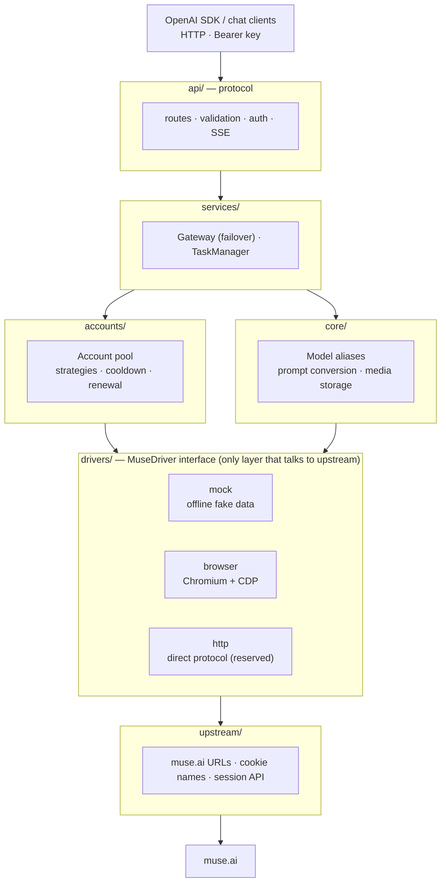

<h1 align="center">muse2api</h1>

<p align="center">
  <b>English</b> | <a href="README.zh-CN.md">中文</a>
</p>

<p align="center">
  An async gateway that exposes the <a href="https://muse.ai">muse.ai</a> web app as an <b>OpenAI-compatible API</b>
</p>

<p align="center">
  
  
  
  
  
</p>

---

## Contents

- [Overview](#overview)
- [Status](#status)
- [Architecture](#architecture)
- [Project layout](#project-layout)
- [Quick start](#quick-start)
- [API examples](#api-examples)
- [Configuration](#configuration)
- [Roadmap](#roadmap)
- [Contributing](#contributing)
- [Disclaimer](#disclaimer)
- [Star History](#star-history)

## Overview

muse2api turns muse.ai's chat, text-to-image and text-to-video features into standard OpenAI endpoints (`/v1/chat/completions`, `/v1/images/generations`, ...). Existing OpenAI SDKs and clients such as ChatGPT-Next-Web, LobeChat or Cherry Studio work by just changing their `base_url`.

The project focuses on **clean engineering and easy collaboration**:

- **Pluggable drivers**: how we reach upstream is abstracted behind a `MuseDriver` interface. There are currently a mock driver and a browser (CDP) driver, plus a reserved slot for a direct-protocol (HTTP) driver. They are fully independent of each other.
- **Strict layering**: the protocol layer, service layer, account pool and drivers each have a single responsibility and can be developed and tested on their own.
- **Fully async**: built on FastAPI + asyncio; the CDP client uses `websockets`, so no request ever blocks a thread.
- **Account pool**: multiple scheduling strategies, per-account concurrency limits, cooldown after failures, automatic removal of expired sessions, and automatic failover to another account.
- **Offline development**: the mock driver needs no account and makes no network calls, so front-end and protocol work can move forward independently.

## Status

> **Current**: the mock-driver test suite passes locally (81 tests, no network access) and CI runs on every push to main; the browser driver and the direct-protocol driver still need live testing against a real muse.ai account.

| Module | Status | Notes |
|---|---|---|
| OpenAI protocol layer (chat streaming/non-streaming, images, videos, models) | ✅ Implemented | Multi-turn chat, system prompts, image input, model aliases |
| Account pool (scheduling / cooldown / invalidation / failover) | ✅ Implemented | `lru`, `round_robin` and `affinity` strategies |
| Background tasks (video) | ✅ Implemented | Create a task, then poll for the result; unfinished tasks are marked interrupted after a restart |
| Admin API (account CRUD, renewal, reset, status) | ✅ Implemented | Accepts cookie dicts, raw `Cookie` header strings and EditThisCookie JSON, plus bulk import via `/admin/accounts/import`; per-account quota snapshot at `/admin/accounts/{id}/quota` |
| Mock driver | ✅ Implemented | Offline fake data |
| Browser driver (Chromium + CDP) | 🧪 Needs live testing | Full chat, image and video flows are written |
| Session renewal / keepalive | 🧪 Needs live testing | Plain HTTP, on by default every 10 min; also wakes the account's VM so the first request is not slowed by a cold start |
| Direct HTTP protocol driver | 🚧 Reserved | Returns 501 |
| `/v1/images/edits` (reference images) | ✅ Implemented | Images are references for a new image; `mask` is rejected |
| `/v1/responses` | ✅ Implemented | Non-streaming and streaming, events match the openai SDK |
| Function calling (`tools`) | ✅ Emulated | Tools go into the prompt; calls in the reply come back as `tool_calls` |
| Streaming heartbeats (SSE keepalive) | ✅ Implemented | Opt-in with `MUSE2API_STREAM_HEARTBEAT_INTERVAL`; sends `: keepalive` comments while waiting for the first token |
| Automatic media cleanup | ✅ Implemented | `MUSE2API_MEDIA_RETENTION_DAYS` (default 14, `0` disables); hourly background pruning |
| SSRF guard for server-side image fetches | ✅ Implemented | Private and loopback URLs are rejected |
| Web dashboard, request log, multiple API keys | ✅ Implemented | Dashboard at `/dashboard`; key CRUD at `/admin/keys`; per-request log and aggregates |
| Quota lookup | ✅ Implemented | Browser driver reads Settings → Usage (plan, weekly %, reset, extra allowance; en / zh-CN / zh-TW) on an idle tab, cached 30 min; mock driver returns a fake snapshot; http driver not wired up |
| VM wake confirmation | ✅ Implemented | After a wake (keepalive or `/admin/accounts/{id}/renew`) the session is polled until the VM is `RUNNING`; an account whose VM is seen down gets no video for 10 min |
| Cookie import browser extension | ✅ Implemented | MV3 popup in `src/muse2api/web/extension/`, downloadable from the dashboard |
| Storage backends (SQLite / Redis) | 🚧 Reserved | Accounts still use a JSON store; the request log is SQLite |
| Prometheus metrics | 🚧 Reserved | Basic aggregates exist at `/admin/stats` |

## Architecture



**How a chat request is handled**: the route resolves the model alias and merges the multi-turn `messages` into a single prompt, then hands it to the Gateway. The Gateway leases an account from the pool and asks the driver for a text stream. On failure, the account's state is updated according to the error type: accounts with an expired session are taken offline, accounts out of quota cool down, and other errors cause a short cooldown. As long as nothing has been sent to the client yet, the request is retried on another account.

For streaming requests, the first chunk is fetched before returning 200. Errors such as "no account available" or "upstream authentication failed" therefore come back with a proper HTTP status code instead of a stream that breaks halfway.

See [docs/ARCHITECTURE.md](docs/ARCHITECTURE.md) for the full design.

## Project layout

```
muse2api/
├── src/muse2api/
│   ├── app.py                 # FastAPI app factory and lifespan
│   ├── config.py              # Settings (environment variables / .env)
│   ├── errors.py              # Error hierarchy → HTTP status + OpenAI error body
│   ├── api/
│   │   ├── deps.py            # Auth and dependency injection
│   │   ├── schemas.py         # OpenAI request models
│   │   └── routes/            # chat / images / videos / media / models / admin / responses
│   ├── services/
│   │   ├── gateway.py         # Runs driver calls on pooled accounts, retries on another account
│   │   ├── tasks.py           # Background long-running tasks
│   │   └── container.py       # Service wiring
│   ├── accounts/              # Account model, JSON store, pool, session keepalive
│   ├── core/                  # Model registry and aliases, prompt conversion, media storage
│   ├── drivers/
│   │   ├── base.py            # MuseDriver interface and data types
│   │   ├── mock.py
│   │   ├── browser/           # cdp.py / chromium.py / dom.py / driver.py
│   │   └── http/              # Reserved
│   └── upstream/muse.py       # Upstream constants and session renewal
├── tests/                     # Mock-driver tests, no network access
├── docs/ARCHITECTURE.md
├── TODO.md                    # Task board for contributors
├── Dockerfile · docker-compose.yml · .env.example
└── CONTRIBUTING.md
```

## Quick start

### Run locally

```bash
git clone https://github.com/www222fff/muse2api.git
cd muse2api
python3 -m venv .venv && source .venv/bin/activate
pip install -e '.[dev]'
cp .env.example .env      # defaults to MUSE2API_DRIVER=mock, no account needed
python -m muse2api        # listens on http://127.0.0.1:18610 by default
```

If `MUSE2API_API_KEY` is not set, a key is generated on first start and saved to `data/api_key`.

### Docker

```bash
cp .env.example .env
docker compose up -d --build
```

### Use a real account (browser driver)

1. Install Chromium or Chrome and set `MUSE2API_DRIVER=browser` in `.env`.
2. Export the cookies from a browser that is logged in to muse.ai. At least `hatch_sess` and `hatch_native_auth_device` are required; `hatch_gw` and `hatch_vml` are passed through when present. Import all muse.ai cookies, including `__Host-` ones.
3. Import the account through the Admin API (see the example below).

## API examples

Every `/v1/*` endpoint requires the header `Authorization: Bearer <API_KEY>`. The `/admin/*` endpoints use `MUSE2API_ADMIN_KEY`, which defaults to the API key when unset.

**Chat (streaming)**

```bash
curl http://localhost:18610/v1/chat/completions \
  -H "Authorization: Bearer $KEY" -H "Content-Type: application/json" \
  -d '{"model":"gpt-4o","messages":[{"role":"user","content":"Hello"}],"stream":true}'
```

**OpenAI Python SDK**

```python
from openai import OpenAI

client = OpenAI(base_url="http://localhost:18610/v1", api_key="<API_KEY>")
resp = client.chat.completions.create(
    model="muse-chat",
    messages=[{"role": "user", "content": "Write a short poem about autumn"}],
)
print(resp.choices[0].message.content)
```

**Multi-turn conversations**

Chat is stateless by default: each request opens a new muse.ai thread and sends the full `messages` history, so clients never share a thread. Pass a stable `user` to keep one conversation on one thread; follow-ups then send only the new user turn, which is faster. The key is scoped by API key, so two keys sending the same `user` stay apart. Each account serves `MUSE2API_ACCOUNT_MAX_CONCURRENCY` conversations at once (default 4), one tab each, and keeps `MUSE2API_WARM_THREADS` started threads (default 2) so a new conversation answers in about 5s instead of 20-40s. Each muse.ai account runs on one cloud VM, and conversations on the same account slow each other down: measured on one account, one request at a time took about 5s, three at once about 20s each, and ten at once 33-95s with a timeout. More tabs per account do not help; for about 10 people use 3 or more accounts, which the pool spreads requests across.

**Text to image**

```bash
curl http://localhost:18610/v1/images/generations \
  -H "Authorization: Bearer $KEY" -H "Content-Type: application/json" \
  -d '{"prompt":"A cyberpunk street on a rainy night","size":"16:9","response_format":"url"}'
```

**Transparent background**

muse.ai only returns flat RGB images, so `"background":"transparent"` cuts the subject out locally (BiRefNet + edge colour estimation) and returns an RGBA PNG. Requires `pip install -e '.[matting]'`; the model (~930MB) is downloaded to `~/.u2net` on first use. Expect ~30s extra per image on CPU.

```bash
curl http://localhost:18610/v1/images/generations \
  -H "Authorization: Bearer $KEY" -H "Content-Type: application/json" \
  -d '{"prompt":"A red fox sitting","background":"transparent"}'
```

**Image from reference images**

`"image"` takes one reference image or a list of up to 4 (data URL, http(s) URL or bare base64). They are attached to the muse.ai message like a chat upload, and the prompt says how to use them, e.g. put a product on a model, or "the same fox, now wearing a red scarf" to keep the subject and scene. `/v1/images/edits` does the same with OpenAI-style multipart uploads, so `client.images.edit()` works; `mask` (inpainting a region) is not supported.

```bash
curl http://localhost:18610/v1/images/generations \
  -H "Authorization: Bearer $KEY" -H "Content-Type: application/json" \
  -d '{"prompt":"A model wearing exactly this hoodie, studio photo","image":"data:image/jpeg;base64,..."}'

curl http://localhost:18610/v1/images/edits \
  -H "Authorization: Bearer $KEY" \
  -F "image[]=@fox.png" -F "prompt=The same fox, now wearing a red scarf"
```

**Image as an async task**

A sync image call (page load plus generation) can take longer than a reverse proxy allows; Cloudflare cuts it after about 100 s with HTTP 524. Add `"async": true` to get a task back, then poll it. Results are always stored as media URLs.

```bash
curl http://localhost:18610/v1/images/generations \
  -H "Authorization: Bearer $KEY" -H "Content-Type: application/json" \
  -d '{"prompt":"A red fox sitting","async":true}'          # -> {"id":"task_xxx","object":"image.task",...}
curl http://localhost:18610/v1/images/generations/task_xxx -H "Authorization: Bearer $KEY"
```

**Text to video (async task)**

```bash
# Create a task; returns {"id": "task_xxx", "status": "queued", ...}
curl http://localhost:18610/v1/videos \
  -H "Authorization: Bearer $KEY" -H "Content-Type: application/json" \
  -d '{"prompt":"Maple leaves falling in a light breeze","duration":5,"size":"16:9"}'

# Poll the task; on success, result.url points to the video
curl http://localhost:18610/v1/videos/task_xxx -H "Authorization: Bearer $KEY"
```

**Import an account**

```bash
curl http://localhost:18610/admin/accounts \
  -H "Authorization: Bearer $ADMIN_KEY" -H "Content-Type: application/json" \
  -d '{"label":"acc1","cookies":{"hatch_sess":"...","hatch_native_auth_device":"..."}}'
```

### Endpoints

| Method | Path | Description |
|---|---|---|
| GET | `/healthz` · `/readyz` | Liveness · readiness (driver state and available accounts) |
| GET | `/v1/models` | Model list, including aliases such as `gpt-4o` and `dall-e-3` |
| POST | `/v1/chat/completions` | Chat, streaming and non-streaming |
| POST | `/v1/images/generations` · GET `/v1/images/generations/{id}` | Text to image (optional `image` references), returns `url` or `b64_json`; `"async": true` returns a task to poll |
| POST | `/v1/images/edits` | Multipart `image`/`image[]` files + `prompt`, OpenAI-compatible |
| POST | `/v1/videos` · GET `/v1/videos/{id}` | Create a video task · query a task |
| GET | `/v1/media/{name}` | Download generated media |
| GET/POST/PATCH/DELETE | `/admin/accounts[/{id}]` | Account CRUD |
| POST | `/admin/accounts/import` | Bulk account import with per-entry error reporting |
| POST | `/admin/accounts/{id}/renew` · `/reset` | Renew session · reset account state |
| GET | `/admin/accounts/{id}/quota[?refresh=1]` | Quota snapshot (cached 30 min; `refresh=1` reads it again; 409 `account_busy` when every tab is busy) |
| GET | `/admin/extension.zip` | The cookie-import Chrome extension |
| GET | `/admin/status` · `/admin/tasks` | Service status · task list |
| GET/POST/PATCH/DELETE | `/admin/keys[/{id}]` | Client API keys (create returns the key once; PATCH renames / revokes) |
| GET | `/admin/requests` · `/admin/stats?window=1h\|24h\|7d` | Request log (filters: `key_id`, `account_id`, `status=2xx\|4xx\|5xx`, `path`, `since`, `hide_polls`) · aggregates |
| GET | `/dashboard` | Web dashboard (asks for the admin key in the browser) |
| POST | `/v1/responses` | OpenAI Responses API (streaming and non-streaming) |

> **Emulated function calling.** muse.ai has no native tool calling, so the
> gateway writes the `tools` of a chat request into the prompt and asks for
> calls as `<tool_call>{"name": ..., "arguments": {...}}</tool_call>` or a JSON
> block. Calls found in the reply come back as OpenAI `tool_calls` with
> `finish_reason: "tool_calls"`, streaming or not; tool results sent back as
> `role: "tool"` messages go into the next prompt. Whether the model emits a
> call is up to it, and `tool_choice` is ignored. With `tools`, a streamed
> reply arrives in one chunk at the end, since it has to be parsed first.
> Sampling parameters (`temperature`, `top_p`, `max_tokens`) are ignored. System and developer messages are
> forwarded inside a `<system_instructions>` block at the start of the prompt
> on a best-effort basis: the muse chat has no native system role, so whether
> the upstream model treats the block as binding instructions is up to it.

### Dashboard, API keys and request log

Open `http://localhost:18610/dashboard` and enter the admin key; it is kept in the browser's local storage and sent as a Bearer token to `/admin/*`. The page shows request volume, error rate and latency, the account pool (enable/disable, renew, reset), a live request log, and API key management.


Each account card shows its quota (usage bar, plan, reset date, age of the reading, with a **Quota** button to read it again), when its session cookie expires, and whether its VM was confirmed running after the last wake. **Import hàng loạt** (bulk import) takes one `label | cookie string` per line.


#### Cookie-import extension

The muse.ai session cookies are httpOnly, so page scripts cannot read them; a small Chrome / Edge extension (Manifest V3, in `src/muse2api/web/extension/`) can.

1. On the dashboard's Accounts page, click **Tải extension** (download extension). It downloads `muse2api-extension.zip`, also served at `GET /admin/extension.zip`. Unzip it.
2. Open `chrome://extensions`, turn on **Developer mode** and click **Load unpacked** on the unzipped folder.
3. Sign in to [muse.ai](https://muse.ai/) in that browser.
4. Open the extension popup, enter the gateway URL (e.g. `http://localhost:18610`) and the admin key, optionally a label, and click import.

The extension reads the muse.ai cookies with their expiry and posts them to `POST /admin/accounts`. Its only fixed host permission is `muse.ai`; it asks for the gateway's origin when you save it, and never stores the cookies. See [its README](src/muse2api/web/extension/README.md) for details.

Besides the admin key and `MUSE2API_API_KEY` (still accepted, logged as `legacy`), `/v1/*` accepts any non-revoked key created on the dashboard or with `POST /admin/keys {"name": "..."}`. Keys look like `m2a-...` and are shown once; `data/keys.json` stores only their SHA-256 hash and an 8-character prefix. Every `/v1/*` request (except `/v1/media/*` downloads) is recorded in `data/requests.db` (SQLite) with its key, model, account, status, latency and client IP (`CF-Connecting-IP` / `X-Forwarded-For` aware). Task status polls are flagged so the dashboard and stats can leave them out.

## Configuration

All settings come from environment variables (prefix `MUSE2API_`) or a `.env` file. See [.env.example](.env.example) for the full list. The most common ones:

| Variable | Default | Description |
|---|---|---|
| `MUSE2API_DRIVER` | `mock` | Driver: `mock` / `browser` / `http` |
| `MUSE2API_HOST` · `MUSE2API_PORT` | `127.0.0.1` · `18610` | Listen address and port |
| `MUSE2API_API_KEY` | auto-generated | Key for `/v1/*` endpoints |
| `MUSE2API_ADMIN_KEY` | same as API key | Key for `/admin/*` endpoints |
| `MUSE2API_REQUEST_LOG_RETENTION_DAYS` | `14` | Days of request history kept in `data/requests.db` |
| `MUSE2API_MEDIA_RETENTION_DAYS` | `14` | Days generated media files are kept in `data/media`; `0` disables automatic cleanup |
| `MUSE2API_STREAM_HEARTBEAT_INTERVAL` | `0` | SSE `: keepalive` comment interval (seconds) while waiting for the first stream token; `0` disables |
| `MUSE2API_PUBLIC_BASE` | empty | Public base URL used in media links; derived from the request when empty |
| `MUSE2API_POOL_STRATEGY` | `lru` | Account scheduling: `lru` / `round_robin` / `affinity` |
| `MUSE2API_MAX_FAILOVER` | `2` | Maximum number of retries on another account |
| `MUSE2API_ACCOUNT_MAX_CONCURRENCY` | `4` | Parallel requests per account (browser driver: one tab each, about 300 MB of memory per tab) |
| `MUSE2API_WARM_THREADS` | `2` | Pre-started threads kept per account. A new muse.ai thread takes 20-40s to answer its first message, a started one about 5s, so chats that need a new thread go into a warm one. Each costs one extra short message of quota; needs a concurrency of at least 2 |
| `MUSE2API_CHROMIUM_PATH` | auto-detected | Path to the browser executable |
| `MUSE2API_KEEPALIVE_ENABLED` | `true` | Periodically renew sessions and wake each account's VM in the background |
| `MUSE2API_KEEPALIVE_INTERVAL` | `600` | Seconds between keepalive rounds |
| `MUSE2API_WAKE_CONFIRM_S` | `20` | Seconds to wait for a woken VM to report `RUNNING` |
| `MUSE2API_QUOTA_CACHE_S` | `1800` | How long a quota reading is reused before muse.ai is asked again |
| `MUSE2API_MATTING_MODEL` | `birefnet-general` | Model for `background: "transparent"` (`birefnet-general-lite` is faster) |

## Roadmap

All reserved modules and outstanding work are tracked in **[TODO.md](TODO.md)**, in four groups:

- **Verification and live testing (do first)**: get the tests passing, test the browser driver against real accounts, and verify image/video generation and session renewal.
- **Drivers**: direct HTTP protocol driver, conversation thread reuse, quota-aware scheduling.
- **Protocol**: mask-based inpainting.
- **Accounts, admin and operations**: storage backends, per-key rate limits, Prometheus metrics.

Each task lists its location, approach and definition of done. Places marked `TODO(contributors)` in the code are the reserved extension points.

## Contributing

You are welcome to pick up any task in [TODO.md](TODO.md). Please open an issue describing what you plan to do before you start; see [CONTRIBUTING.md](CONTRIBUTING.md) for conventions.

```bash
pytest           # all tests use the mock driver
ruff check .     # lint
```

## Disclaimer

This project is for learning and technical research only. Please comply with muse.ai's terms of service and local laws. Never commit or publish account cookies.

## Star History

[](https://star-history.com/#www222fff/muse2api&Date)

## License

[MIT](LICENSE)
